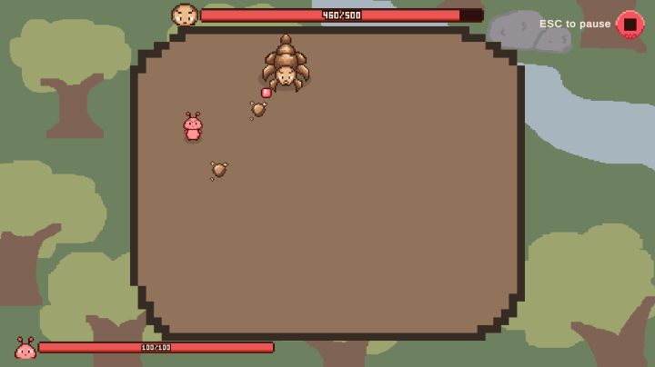
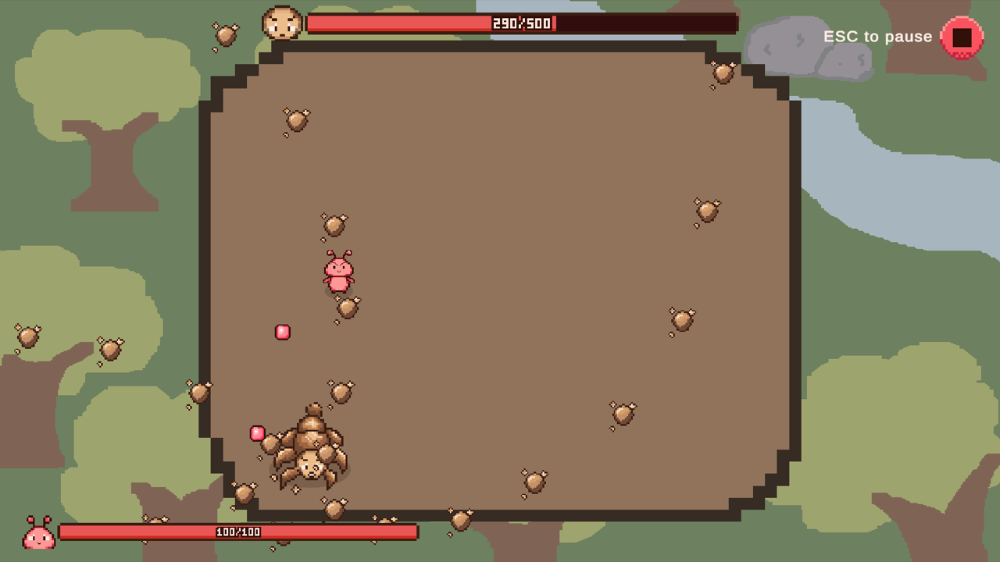
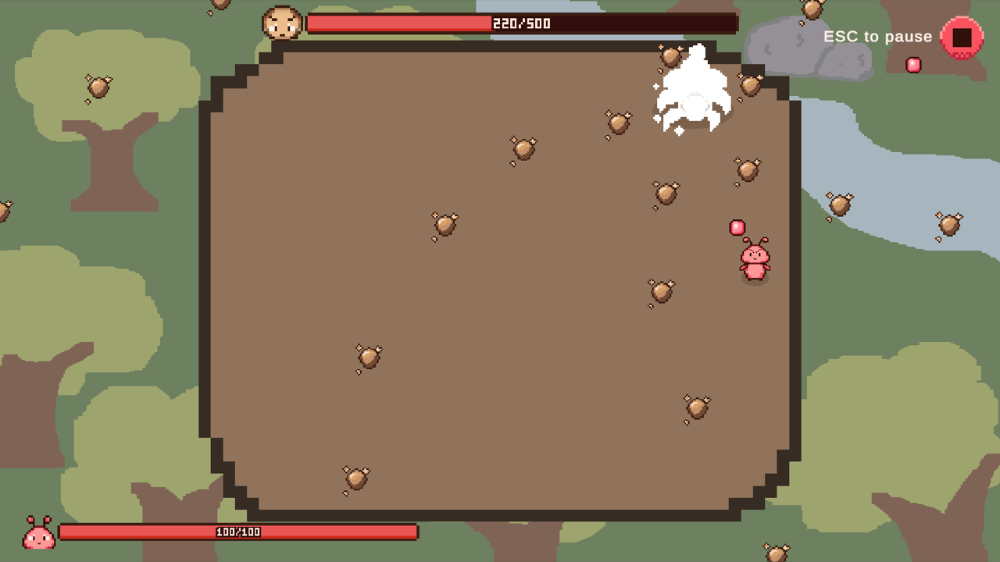
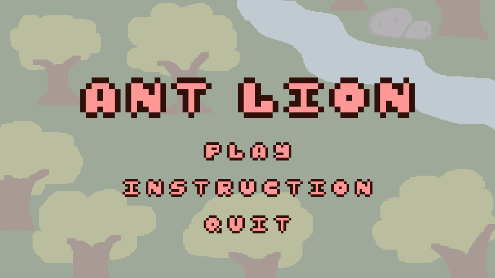
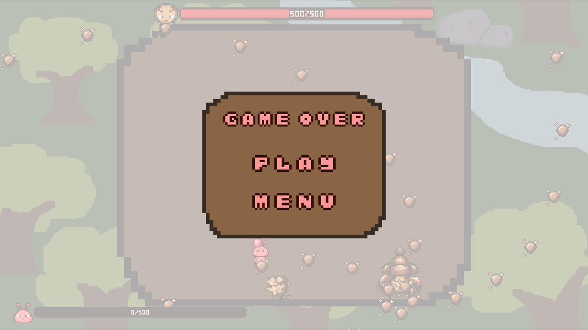

# Ant Lion

**A pixel-art bullet-hell boss fight.** You're a tiny ant who fell into an antlion's pit. Dodge waves of projectiles, dash through danger, and shoot back until the antlion goes down, before it does the same to you.



Made in Unity 6 for **IAT 312**, as a redesign of an earlier Flash game. The design goals are **Challenge, Sensation, and Fantasy**: boss patterns are meant to be readable and learnable, so every hit you take feels like something you can fix next time.

---

## The fight

<table>
  <tr>
    <td width="50%"></td>
    <td width="50%"></td>
  </tr>
  <tr>
    <td><b>Read the pattern, find the gap.</b> The boss cycles through four attacks. Each one has a short wind-up you can learn to spot.</td>
    <td><b>Punish the recovery.</b> After every attack the boss slows down for a moment. That's your window to land hits.</td>
  </tr>
</table>

### The antlion's attacks

The boss runs these in order, then loops:

| Pattern | What it does | How to survive |
|---|---|---|
| **Aimed Shot** | A rapid stream of 10 single bullets, re-aimed at you every shot. | Keep moving sideways. Standing still is the only way to get hit. |
| **Aimed Spread** | Three volleys of 5-bullet fans, each aimed at where you are. | Move between volleys. The fan re-aims, so stepping out of it is enough. |
| **Spiral** | A rotating 5-armed spiral of bullets that sweeps the arena. | Find the gap between two arms and rotate with it. |
| **Radial Burst** | Four rings of 20 bullets. Each ring is offset from the one before. | Slip through a gap in one ring, then sidestep for the next. |

While it attacks, the antlion **circles you** at a set distance, moving across your line of fire so it's hard to hit. Every so often it stops and reverses direction. That pause is a tell, and an easy shot.

### Your toolkit

- **Shoot.** Hold the mouse to fire a steady stream at the cursor.
- **Dash.** A quick burst of speed. You're **invulnerable while dashing**, so you can dash straight through bullets if your timing is right. It has a short cooldown.
- **Don't touch the boss.** Running into the antlion hurts and knocks you back.

| | HP |
|---|---|
| Ant (you) | 100 |
| Antlion | 500 |

Bring the antlion's bar to zero to win. If yours empties first, it's game over, and you can jump straight back in.

<p align="center">
  
  
</p>

---

## Controls

| Action | Input |
|---|---|
| Move | W A S D |
| Shoot | Left mouse button (aim with the mouse) |
| Dash | Space |
| Pause / resume | Esc |

---

## How it's built

The project keeps data, systems, controllers, and presentation in separate layers, so tuning the fight never means editing code:

- **Attack patterns are ScriptableObjects.** Each pattern is an asset (`Pattern_Spiral`, `Pattern_RadialBurst`, ...) with its timing, bullet counts, and angles exposed in the Inspector. The boss just holds a list of them, which is also the hook for a future phase 2.
- **The boss brain is a small state machine** (Attack → Recover → Attack ... → Dead), running alongside its circling movement.
- **Projectiles are pooled.** Dense patterns spawn a lot of bullets, so nothing is created or destroyed during the fight. Player and boss bullets are two variants of one `Projectile` prefab, and the physics collision matrix decides what can hit what.
- **One shared `Health` component** drives both HP bars, the hit flash, and the win/lose screens through events.

See [ARCHITECTURE.md](ARCHITECTURE.md) and [LAYERS.md](LAYERS.md) for the details.

---

## Playing the game

### Windows

1. Open `Builds/AntLion_Windows/AntLion_Windows/`.
2. Double-click **`AntLion BulletHell.exe`**.

Keep the whole folder together. The `.exe` needs the `AntLion BulletHell_Data` folder and `UnityPlayer.dll` next to it.

If Windows SmartScreen shows "Windows protected your PC", click **More info**, then **Run anyway**.

### macOS (Apple Silicon)

1. Open `Builds/AntLionBuild_Mac/`.
2. Double-click **`AntLion_Mac.app`**.

The build is for **Apple Silicon Macs (M1 or newer)**. On an Intel Mac, run the game from the Unity editor instead (see below).

<details>
<summary><b>If macOS won't open it</b></summary>

The app isn't notarized by Apple, so macOS may say it "can't be opened", "is damaged", or comes from an "unidentified developer".

**Option A: right-click it.** Right-click (or Control-click) `AntLion_Mac.app`, choose **Open**, then click **Open** again in the dialog. You only need to do this once.

**Option B: use Terminal.** `cd` into the folder that contains `AntLion_Mac.app`, then run:

```bash
xattr -dr com.apple.quarantine AntLion_Mac.app
chmod +x "AntLion_Mac.app/Contents/MacOS/AntLion BulletHell"
open AntLion_Mac.app
```

The first line removes the "downloaded from the internet" flag that makes macOS block the app. The second makes sure the game's executable can run, in case unzipping dropped that permission. The third launches the game.

If it still won't open, go to **System Settings → Privacy & Security**, scroll down to the message about `AntLion_Mac.app`, and click **Open Anyway**.

</details>

### From the Unity Editor

1. Install **Unity 6000.6.0f1** through Unity Hub. Use this exact version; other versions may upgrade or break the project.
2. In Unity Hub, click **Add → Add project from disk** and select this folder (the one containing `Assets/` and `ProjectSettings/`).
3. Open the project. The first import can take a few minutes.
4. Open `Assets/_Project/Scenes/MainMenu.unity` and press **Play** (▶).

Start from `MainMenu.unity` to play the game the way players see it (main menu → instructions → arena → win/lose screen). `Sandbox_A` and `Sandbox_B` are test scenes, not part of the game.

---

## Credits

Made by [technomechno](https://github.com/TechnoMechno) and [annguyenn03](https://github.com/annguyenn03) for IAT 312.
